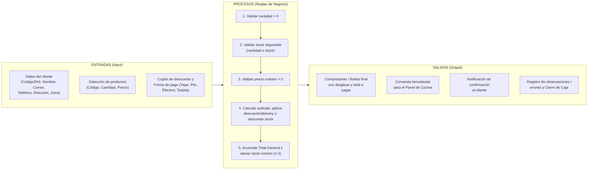

#  Broaster Go — Proyecto de Automatización de Pedidos, Caja y Stock

> **Universidad Privada del Norte (UPN)**  
> **Curso:** Fundamentos de Programación  
> **Docente:** Marlene Pilar Aguilar Suares  
> **Caso de Estudio:** Sistema de Gestión y Registro de Pedidos en Caja y Delivery ("Broaster Go")

---

##  Equipo de Desarrollo (Grupo 2)

| Integrante | Código | Rol y Responsabilidad en el Proyecto |
| :--- | :---: | :--- |
| **Tejada Paredes, Daniel Alexander** *(Coordinador)* | `N00529592` | Coordinación general, integración de capa de datos (`BaseDatos` / SQLite) y carga de informes |
| **Santillan Echevarria, Felipe Rumi Atipaj** | `N00531681` | Documentación técnica, módulo de salidas y reportes (`Documentos`: boleta, comanda, cierre de caja) |
| **Gonzales Llontop, Adrihan Smith** | `N00529812` | Lógica de negocio (`Cliente`, `Producto`, `Pedido`, `SistemaPedidos`), procesamiento y validación de variables |
| **Orellana Ramirez, José Julian** | `N00549216` | Capa de presentación con interfaz gráfica (`VentanaPedido` en Tkinter), funciones de autenticación y validación |
| **Alor Durán, Giovanni Anderson** | `N00534304` | Control de calidad y pruebas integrales de ejecución (`test_pedidos`: casos borde de stock, montos y pagos) |

---

##  1. Contexto del Proyecto y Problemática

En la gestión diaria de la pollería **"Broaster Go"** —cuyo objetivo operativo es entregar pollos a la brasa/broaster y complementos en **menos de 45 minutos** en horario continuo de `12:00 a 23:00` (con horas punta de `13:00–15:00` y `19:00–22:00`)—, los pedidos que ingresan por **WhatsApp, Instagram, llamadas telefónicas y formulario web** se registraban manualmente en un cuaderno y luego se transcribían a una hoja de Excel.

### Problemas Identificados en el Proceso Manual
1. **Demoras críticas en la atención:** Cada pedido tomaba entre **4 y 6 minutos** en registrarse durante horas pico.
2. **Retrasos y quiebres en la validación de inventario:** El stock se contaba a mano al final del día, agotándose productos sin previo aviso.
3. **Errores manuales de cálculo:** Equivocaciones frecuentes al sumar subtotales, tarifas de delivery por zona (`S/ 3` a `S/ 8`) y cupones de descuento con calculadora.
4. **Falta de sincronización con cocina y reparto:** Pedidos duplicados al entrar por dos canales distintos, mensajes perdidos y falta de trazabilidad del estado del pedido (`Registrado → En cocina → En ruta → Entregado`).

---

##  2. Análisis del Problema (Modelo IPO: Entradas, Procesos y Salidas)



| Entradas (Datos que ingresan) | Procesos (Transformaciones y Reglas) | Salidas (Resultados) |
| :--- | :--- | :--- |
| Datos del cliente (código/DNI, nombre, teléfono, dirección, correo) | Registrar y validar datos del cliente y cobertura de zona | Ficha confirmada del cliente |
| Código de producto, cantidad solicitada y precio unitario | Validar `cantidad > 0`, `precio > 0` y calcular subtotal (`Precio × Cantidad`) | Lista de productos confirmados |
| Stock disponible de pollos e insumos | Verificar `cantidad ≤ stock`, descontar inventario y alertar stock mínimo (`≤ 3`) | Comanda para el área de cocina |
| Cupones vigentes, tarifa de delivery por zona y forma de pago | Confirmar pago, aplicar descuentos/delivery y consolidar ventas del día | Boleta de venta, notificación al cliente y reporte de cierre de caja |

---

## 3. Estructura del Repositorio e Implementación en Python

El repositorio contiene los prototipos funcionales desarrollados en **Python 3** (sin dependencias externas), abarcando la programación orientada a objetos (POO), la validación en consola y la interfaz gráfica con `Tkinter`:

| Archivo | Descripción |
| :--- | :--- |
| [`broaster_go_pedidos.py`](./broaster_go_pedidos.py) | **Prototipo Principal POO (Control de Stock + Boleta + Cocina + Cierre de Caja):** Implementa las clases `Cliente`, `Producto` y `SistemaPedidos` (`@staticmethod procesar_pedido`). Aplica las reglas **R1 a R8** (cantidad, precio, stock, pedido mínimo y tarifa de delivery por zona, cupones, forma de pago y alerta de stock mínimo), valida los datos del cliente, permite registrar varios pedidos seguidos y termina con el **cierre de caja** del día. |
| [`broaster_go.py`](./broaster_go.py) | **Prototipo de Mostrador en Consola (CLI):** Menú interactivo de combos, validación de entradas numéricas, aplicación de cupones porcentuales de descuento y desglose de **IGV (18%)**. |
| [`broaster_go_gui.py`](./broaster_go_gui.py) | **Prototipo con Interfaz Gráfica (`Tkinter`):** Clase `VentanaPedido` con selector desplegable (`ttk.Combobox`), lista de ítems, subtotal en vivo, botón para quitar artículos, validación del descuento (0–100 %) y limpieza automática al finalizar cada pedido. |
| [`calculos.py`](./calculos.py) | **Módulo compartido:** carta, IGV y cálculo de totales que usan la consola y la ventana (así no se repite el código). El descuento se aplica **antes** del IGV. |
| [`test_pedidos.py`](./test_pedidos.py) / [`test_calculos.py`](./test_calculos.py) | **Pruebas automáticas (`unittest`):** 24 casos que verifican las reglas R1–R8, la validación del cliente, el cierre de caja y los cálculos de IGV y descuento. |
| [`docs/Mejoras_BroasterGo.pdf`](./docs/Mejoras_BroasterGo.pdf) | Guía breve de las mejoras agregadas al proyecto. |

---

## 4. Ejecución y Pruebas de Calidad (Terminal)

### Requisitos
- **Python 3.10 o superior** (incluye `tkinter` en la biblioteca estándar).

### Clonar y ejecutar
```bash
git clone https://github.com/RumiSantins/BroasterGo.git
cd BroasterGo

# 1. Ejecutar el sistema POO con validación de stock y comanda de cocina:
python broaster_go_pedidos.py

# 2. Ejecutar la interfaz gráfica de escritorio (Tkinter):
python broaster_go_gui.py

# 3. Ejecutar la versión de mostrador con IGV y cupones:
python broaster_go.py
```

### Ejecutar las pruebas automáticas
```bash
python -m unittest -v
```
Si todo está bien, al final aparece `Ran 24 tests ... OK`.

### Datos para probar `broaster_go_pedidos.py`
| Regla | Valores |
| :--- | :--- |
| Zonas de delivery (R5) | `A` = S/ 3.00, `B` = S/ 5.00, `C` = S/ 8.00 |
| Pedido mínimo para delivery (R4) | S/ 25.00 |
| Cupones (R6) | `BROASTER10` (10 %), `FAMILIA15` (15 %) |
| Formas de pago (R7) | Efectivo, Yape, Plin, Tarjeta |
| Alerta de stock (R8) | cuando quedan 3 unidades o menos |

### Evidencia de Ejecución (`broaster_go_pedidos.py`)
Pedido con delivery a la zona B, cupón `FAMILIA15` y pago con Yape. Al terminar se muestra la alerta de stock mínimo y el cierre de caja:

```text
=== BROASTER GO - Nuevo Pedido ===
Código del cliente: 529592
Nombre del cliente: Daniel
Correo del cliente: alexandertejadaparedes@gmail.com

--- Menú disponible ---
P001 - Pieza de Pollo Broaster - S/ 8.50 - Stock: 10
P002 - Combo 2 Piezas + Papas - S/ 18.00 - Stock: 5
P003 - Papas Fritas - S/ 6.00 - Stock: 15
P004 - Gaseosa 500ml - S/ 4.00 - Stock: 20

Ingresa los productos del pedido. Escribe 'fin' para terminar.

Código de producto: P002
Cantidad de 'Combo 2 Piezas + Papas': 4

Código de producto: P003
Cantidad de 'Papas Fritas': 2

Código de producto: fin

¿Es para delivery? (S/N): S
Zonas (pedido mínimo S/ 25.00):
 Zona A: S/ 3.00
 Zona B: S/ 5.00
 Zona C: S/ 8.00
Zona: B

Cupón de descuento (Enter si no tiene): FAMILIA15

Formas de pago:
 1. Efectivo
 2. Yape
 3. Plin
 4. Tarjeta
Elige una opción: 2

==========================================
=== BOLETA N.º 0001 - BROASTER GO ===
==========================================
Cliente: Daniel (529592)

 Productos Confirmados:
 - Combo 2 Piezas + Papas x4 - S/ 72.00
 - Papas Fritas x2 - S/ 12.00

 Subtotal:  S/ 84.00
 Descuento: -S/ 12.60 (cupón FAMILIA15, 15%)
 Delivery:  S/ 5.00 (zona B)
 Total a pagar: S/ 76.40  (Yape)

 Notificación de confirmación:
 Enviado a: alexandertejadaparedes@gmail.com

 Pedido enviado al Panel de Cocina:
 - 4 x Combo 2 Piezas + Papas
 - 2 x Papas Fritas

 ALERTA de stock mínimo (reponer pronto):
 - Combo 2 Piezas + Papas: solo quedan 1

¿Registrar otro pedido? (S/N): N

==========================================
=== CIERRE DE CAJA - BROASTER GO ===
==========================================
Pedidos confirmados: 1
Pedidos rechazados:  0
Total vendido:       S/ 76.40

Ventas por forma de pago:
 - Efectivo: S/ 0.00
 - Yape: S/ 76.40
 - Plin: S/ 0.00
 - Tarjeta: S/ 0.00

Stock final:
 - Pieza de Pollo Broaster: 10
 - Combo 2 Piezas + Papas: 1
 - Papas Fritas: 13
 - Gaseosa 500ml: 20
```

---

## 5. Cuadro Comparativo de Alternativas y Justificación

Durante el diseño se evaluaron tres alternativas tecnológicas para la pollería:

| Criterio | Alternativa Algorítmica 1: Python CLI + JSON/CSV | Alternativa Algorítmica 2 (Elegida): Python GUI (`Tkinter`) + SQLite | Alternativa de Tercerización: Software SaaS / POS Comercial |
| :--- | :--- | :--- | :--- |
| **Enfoque técnico** | Consola (CLI) con POO y archivos planos JSON/CSV. | Interfaz gráfica (`Tkinter`) desacoplada en capas con BD transaccional (`SQLite`). | Plataforma comercial en la nube con suscripción mensual. |
| **Requerimientos** | Python 3.x estándar y terminal de comandos. | Python 3.x con `tkinter` y `sqlite3` nativos en PC estándar. | Internet continuo de alta velocidad y equipos homologados. |
| **Costo de referencia** | **S/ 0.00** (desarrollo propio). | **S/ 0.00** (herramientas nativas de código abierto). | **S/ 120 a S/ 250 / mes** + S/ 300 a S/ 500 de implementación. |
| **Viabilidad operativa** | **Media:** Funcional, pero requiere digitación en consola en horas punta. | **Óptima:** Formularios rápidos (< 1 min por pedido) y control de stock en tiempo real. | **Baja a Media:** Gasto fijo elevado (> S/ 1,440 anuales) y poca flexibilidad a reglas propias. |

---

## 6. Reglas de Negocio y Diseño Arquitectónico

### 6.1 Reglas de Negocio del Algoritmo

| N.º | Regla | Implementación en el Sistema |
| :---: | :--- | :--- |
| **R1** | **Cantidad válida** | La cantidad solicitada debe ser un número entero mayor que `0` (`validarItem`). |
| **R2** | **Precio válido** | El precio unitario del producto debe ser mayor que `0` (`validarItem`). |
| **R3** | **Stock suficiente** | `cantidad ≤ stock disponible`; se descuenta atómicamente para evitar vender productos agotados. |
| **R4** | **Pedido mínimo** | Para envíos a domicilio, el subtotal de productos debe ser de al menos **S/ 25.00**. |
| **R5** | **Delivery por zona** | Tarifa escalonada según cobertura: Zona A = `S/ 3.00`, Zona B = `S/ 5.00`, Zona C = `S/ 8.00`. |
| **R6** | **Cupones y combos** | Si el cupón está vigente, `descuento = subtotal × (porcentaje / 100)`. |
| **R7** | **Formas de pago** | Yape, Plin, efectivo o tarjeta; el pedido solo se confirma con pago verificado. |
| **R8** | **Alerta de stock** | Al descontar inventario, el sistema emite alerta si el stock restante cae a `≤ 3 unidades`. |

### 6.2 Organización por Capas y Modelo de Datos

| Capa | Clase / Módulo | Funciones Principales | Responsable |
| :--- | :--- | :--- | :--- |
| **Presentación (`Tkinter`)** | `VentanaPedido` | `capturarCliente()`, `seleccionarProducto()`, `capturarCupon()`, `mostrar()` | Orellana |
| **Lógica de Negocio** | `Cliente`, `Producto`, `Pedido`, `SistemaPedidos` | `procesar_pedido()`, `validarCliente()`, `validarItem()`, `calcularTotales()`, `confirmarPago()` | Gonzales |
| **Datos (`SQLite`)** | `BaseDatos` | `abrirBaseDatos()`, `consultarStock()`, `descontarStock()`, `guardarPedido()` | Tejada |
| **Salidas y Reportes** | `Documentos` | `emitirBoleta()`, `enviarComanda()`, `notificarCliente()`, `cerrarCaja()` | Santillan |
| **Pruebas y QA** | `test_pedidos` | Pruebas de cantidad `≤ 0`, stock insuficiente, precio inválido, pedido `< S/ 25` | Alor |

#### Esquema Relacional Propuesto
- **`cliente`**: `codigo (PK)`, `nombre`, `telefono`, `direccion`, `correo`, `zona` *(1 cliente → N pedidos)*
- **`producto`**: `codigo (PK)`, `nombre`, `precio`, `stock`, `stock_minimo` *(1 producto → N detalles)*
- **`pedido`**: `id (PK)`, `cliente_codigo (FK)`, `fecha_hora`, `subtotal`, `descuento`, `delivery`, `total`, `forma_pago`, `estado` *(1 pedido → N detalles)*
- **`detalle_pedido`**: `id (PK)`, `pedido_id (FK)`, `producto_codigo (FK)`, `cantidad`, `subtotal` *(Une pedido y producto)*

---

## 7. Trazabilidad de Soluciones y Conclusiones

| N.º | Problema del Registro Manual | Solución Implementada en el Sistema |
| :---: | :--- | :--- |
| **1** | Errores de digitación o transcripción | Captura única validada con `validarCliente()`, eliminando el doble paso cuaderno → Excel. |
| **2** | Datos duplicados o inconsistentes | Registro centralizado con identificador único de pedido y código de cliente. |
| **3** | Pérdida o deterioro de documentos | Persistencia digital estructurada en lugar de apuntes en papel y chats dispersos. |
| **4** | Demora en consultas y reportes | Consolidación automática de ventas mediante `cerrarCaja()`. |
| **5** | Falta de trazabilidad del pedido | Flujo de estados (`Registrado → En cocina → En ruta → Entregado`) y emisión inmediata de comanda. |
| **6** | Dependencia de una sola persona | Interfaz intuitiva y validaciones automáticas que permiten operar a cualquier cajero de turno. |
| **7** | Cálculos manuales propensos a error | Cálculo automatizado de subtotales, IGV, descuentos y tarifas de delivery. |
| **8** | Falta de control del inventario | Verificación previa de disponibilidad y descuento inmediato de stock por cada ítem vendido. |
